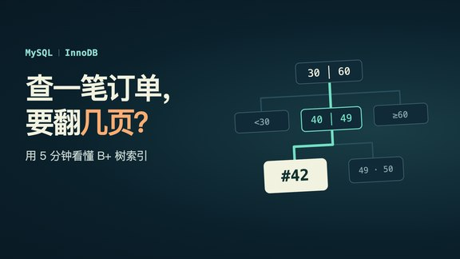

# Lesson Video Maker · 动画教学视频制作

一个 Codex Skill，把「想讲什么、讲给谁、讲多久」变成带口播的动画教学视频。Codex 编写口播和分镜，制作可离线播放的 HTML 课件，再把动画和字幕对齐到实测语音时间轴，导出 1080p MP4、SRT 字幕、封面和投稿文案。成片可以提交到抖音和 B 站。

## 作品集

下面是我用这个 Skill 制作的作品。输入栏摘录了原需求，GitHub 样例包含对应的 JSONL 剧本、HTML 动画源码、成片字幕和封面。

[](examples/mysql-bplus/)

| 我的输入 | 得到的作品 | 源文件和成片 |
| --- | --- | --- |
| 「做一个五分钟的教学视频，详细介绍 MySQL 的 B+ 树索引。」 | **查一笔订单要翻几页？** 跟着一笔订单看 InnoDB 逐页查找、范围扫描、回表、覆盖索引和页分裂。5 分钟。 | [GitHub 样例](examples/mysql-bplus/) · [抖音成片](https://www.douyin.com/video/7711568237292490019) |
| 「做一个不一样的《晏子使楚》小学生课文讲解，三分钟，上传 B 站。」 | **如果你是晏子，会怎么接招？** 用剪纸风动画讲城门、大殿和宴席三个情节，最后带学生复述课文。约 3 分钟。 | [GitHub 样例](examples/yanzi-chu/) · [抖音成片](https://www.douyin.com/video/7711375312189181210) · [B 站成片](https://www.bilibili.com/video/BV1LmySz8EmS/) |
| 「换个题目做一个三分钟的视频，转场要平滑，重点跟着口播高亮。」 | **消息处理成功了，为什么还会重投？** 选用订单重复加积分的例子，讲 RabbitMQ 的 ACK、重投和幂等。约 3 分钟。 | [GitHub 样例](examples/message-queue/) · [B 站成片](https://www.bilibili.com/video/BV1X9ySzsExQ/) |

## 在 Codex 中使用

把仓库克隆到个人 Skill 目录。工作区内使用时，把目标目录改为 `.agents/skills/lesson-video-maker`。安装后开启一个新的 Codex 对话。[Codex Skill 安装位置](https://developers.openai.com/api/reference/cli)

```sh
mkdir -p ~/.agents/skills
git clone https://github.com/loseaa/lesson-video-maker.git ~/.agents/skills/lesson-video-maker
```

macOS 需要 Python 3.10+、Node.js 22+、Google Chrome、FFmpeg 和 ffprobe。在仓库或 Skill 根目录运行以下命令，使用同一个 Python 环境安装 Pillow 并启动 `render.sh`。

```sh
python3 -m venv .venv
source .venv/bin/activate
python -m pip install -r requirements.txt
```

在 Codex 中试试这些提示词。

> 用 $lesson-video-maker 做一支五分钟视频，给刚学 SQL 的同学讲 MySQL 的 B+ 树索引。

> 用 $lesson-video-maker 把《晏子使楚》做成一支三分钟动画，讲给小学高年级的同学听。

推荐使用豆包语音合成 2.0，密钥在本机配置。免 Key 时用 macOS 的 `say` 配音，选择中文语音 Tingting。覆盖 Chrome 路径用 `LESSON_VIDEO_MAKER_CHROME`。[豆包配音设置](references/doubao-tts.md)

## 从已有剧本渲染

在仓库根目录运行下方命令，可以用作品集中的 B+ 树素材重新配音和渲染。写自己的剧本和动画时，参考 [JSONL 格式](references/storyboard.md) 和 [HTML 分镜约定](references/html-scenes.md)。重复渲染可以复用工作目录里的旁白缓存，每次提供一个新的输出目录。

```sh
skill_dir="$PWD"
sh ./render.sh build "$skill_dir/examples/mysql-bplus/timeline.jsonl" \
  --html-deck "$skill_dir/examples/mysql-bplus/scenes" \
  --work-dir "$skill_dir/work/mysql-bplus" \
  --output "$skill_dir/outputs/mysql-bplus" \
  --tts doubao
```

成品包括 `video.mp4`、可离线播放和跳章的 `deck/index.html`、`subtitles.srt`、带实测时间的 `timeline.jsonl`、`cover.png` 和 `post.md`。分享 HTML 课件时请保留整个 `deck/` 目录。

## 投稿

按需配置 [B 站投稿](references/bilibili-publish.md) 或 [抖音投稿](references/douyin-publish.md)。两者分别依赖单独安装的 `biliup` 和 `sau`，并复用本机已授权的登录态。本机路径、登录凭据和个人浏览器配置单独保存。

```sh
sh ./render.sh publish-bilibili /path/to/delivery --dry-run
sh ./render.sh publish-douyin /path/to/delivery --dry-run
```

确认标题、简介、话题和目标账号后，去掉 `--dry-run` 提交。

## 运行测试

```sh
python -B -m unittest discover -s tests
node --test tests/*.test.cjs
```
